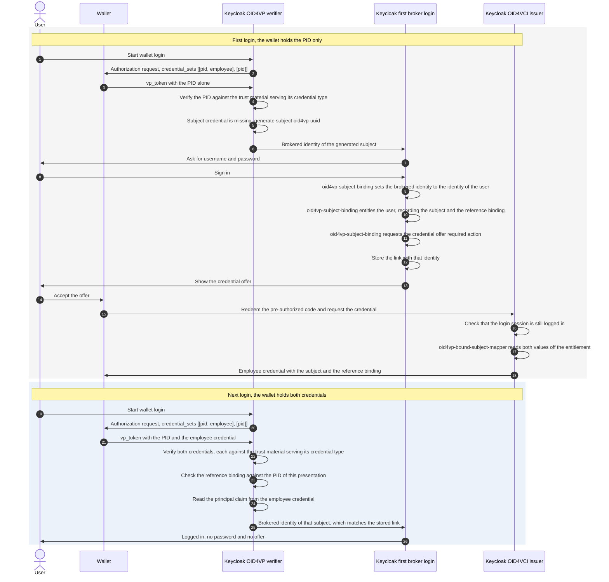

# Configuration Reference

For step-by-step instructions, see the [Setup Guide](setup.md).

## Configuration Locations

| Configuration | Where to set |
|---------------|--------------|
| Extension settings | Keycloak identity provider config, through the Admin UI, a realm import JSON or the Admin API. `allowedIssuers`, `clockSkewSeconds`, `kbJwtMaxAgeSeconds`, `x509SigningKeyJwk`, `sse*` and `crossDeviceCompleteTtlSeconds` have no Admin UI field |
| Listeners and other providers | Keycloak SPI options, see the [SPI Reference](spi-reference.md) |

## Settings

### Credential Request

The extension generates the DCQL query from the [OID4VP mappers](#idp-mappers). The mapper type sets the credential format, and the mapper configuration sets the credential type and claim path. At least one mapper with a credential type is required.

| Key | Default | Description |
|-----|---------|-------------|
| `credentialSets` | none | DCQL `credential_sets` in specification syntax, referencing credential ids |
| `requestObjectLifespanSeconds` | `10` | Lifespan of the signed request object JWT |
| `sameDeviceRequestUriLifetimeSeconds` | `300` | Time after page load in which a wallet can fetch the same-device request object. After that, the page offers a fresh link |
| `crossDeviceRequestUriLifetimeSeconds` | `300` | The same for the cross-device request object behind the QR code |
| `maxLiveRequestsPerLogin` | `10` | Wallet requests of one login that stay valid across fresh links. Minimum `2` |

- A wallet that fetched the request object in time can present until the authentication session expires.
- The page issues one request per enabled flow each time. Beyond `maxLiveRequestsPerLogin` the oldest requests end, and the verifier rejects a wallet still answering one.

Mapper `credential.id`:

- Mappers sharing an id form one credential entry, which accepts every credential type they name. Use this to request a type twice with different claims, or to accept several VCTs.
- A [derived type](#credential-type-inheritance) satisfies the request too.
- An empty id derives from the format and first credential type, for example `sdjwt_urn_eudi_pid_1` or `mdoc_org_iso_18013_5_1_mDL`.
- DCQL allows letters, digits, `_` and `-`.

`credentialSets` lists alternative combinations in order of preference. This example requests a PID with an mDL and accepts the PID alone:

```json
[{"purpose": "Login", "options": [["sdjwt_urn_eudi_pid_1", "mdoc_org_iso_18013_5_1_mDL"], ["sdjwt_urn_eudi_pid_1"]]}]
```

- `required` defaults to `true`. `"required": false` marks an optional extra credential.
- Without `credentialSets`, DCQL requires every credential in the query.
- Keycloak validates on save. The extension validates again at query build, because IdP mappers have no validation hook.
- The verifier rejects a login that satisfies no option of a required set.

### User Mapping

| Key | Default | Description |
|-----|---------|-------------|
| `principalAttributes` | none | Claims that identify the user, as comma separated `credentialId:claimPath` entries in the order tried, see [Subject Claim](#subject-claim) |
| `allowMissingSubjectCredential` | `false` | Accepts a presentation without the [subject credential](#keycloak-issued-subject-credential). Requires `principalAttributes`, which names the credentials that may be missing |
| `referenceBindingClaim` | `oid4vp_reference_binding` | Claim carrying the [reference credential binding](spi-reference.md#reference-credential-binding-spi) of a credential this Keycloak issues. Set the same name on `oid4vp-bound-subject-mapper` |
| `doNotStoreUsers` | `false` | Native Keycloak IdP setting. Enables [transient login](#transient-login-mode) and ignores configured identifying claims. Requires the `transient-users` feature |

Logins require `principalAttributes` unless transient users are enabled. Without it, the identity provider refuses logins and only serves the [presentation authenticator and required action](#presentation-authenticator-and-required-action).

### Subject Claim

`principalAttributes` names the subject claim per credential, because the claim differs between credentials.

```properties
principalAttributes = sdjwt_urn_eudi_pid_1:sub, mdoc_eu_europa_ec_eudi_pid_1:eu\.europa\.ec\.eudi\.pid\.1.family_name
```

| Format | Claim path | Example |
|--------|------------|---------|
| SD-JWT | The claim | `employee:sub`, nested `employee:credential_subject.id` |
| mDoc | Namespace, then data element. Escape namespace dots with a backslash | `eu\.europa\.ec\.eudi\.pid\.1` for `eu.europa.ec.eudi.pid.1` |

- Paths start at the root of what the credential presented.
- The verifier never infers the namespace, so a credential carrying a second namespace cannot supply the subject.
- The verifier tries entries in order, and the first credential the wallet presented supplies the subject. The wallet has no say.

Keycloak checks on save:

- Every required credential set option contains a named credential. `allowMissingSubjectCredential` lifts this rule.
- Every named credential requests its claim in every claim set option. The generated query adds that claim to the credential's entry.
- Each credential is named once.

### Keycloak-Issued Subject Credential

This mode suits a PID without an identifier of its own, such as the German PID. The PID carries the attributes, and a credential this Keycloak issues carries the user identifier.

Identity provider:

```properties
credentialSets                = [{"options": [["pid", "employee"], ["pid"]]}]
principalAttributes           = employee:sub
allowMissingSubjectCredential = true
```

Authenticator `oid4vp-subject-binding`:

```properties
credentialConfigurationId = employee-credential
offerClientId             = wallet-vci
```

| Key | Description |
|-----|-------------|
| `credentialConfigurationId` | Issuer credential configuration of the offer. Empty means no offer |
| `offerClientId` | Client the offer addresses. The wallet requests the credential as this client |

The first broker login flow must authenticate the user: `idp-username-password-form` followed by `oid4vp-subject-binding`, both required. The default flow creates a user when nothing matches, and a German PID matches nothing.

| Presented | Result |
|-----------|--------|
| Both credentials | The employee credential's principal claim holds the account subject. Normal wallet login |
| PID alone | The verifier generates a subject `oid4vp-<uuid>`. Keycloak runs the first broker login flow, and the user signs in with username and password. `oid4vp-subject-binding` sets the brokered identity to that user before Keycloak stores the link, entitles the user, and ends the login in the Keycloak credential offer required action |

- The claim named in `principalAttributes` can be any claim the issuer writes the subject into. It must equal `claim.name` on the issuing mapper.
- `oid4vp-bound-subject-mapper` writes the reference credential binding and a subject derived from the Keycloak user id with a realm secret, so wallets and verifiers read an opaque value.
- The offer is bound to its login. Keycloak accepts the pre-authorized code only while that session is logged in and the user and password are unchanged.
- Keycloak offers a credential only to an entitled user. The authenticator grants the entitlement and records the subject and reference credential binding on it. An entitlement granted by an administrator yields a credential that identifies nobody.
- The authenticator offers on every login it binds, even for an entitled user. It only runs when the presentation carried no subject credential.
- A user who lost the credential signs in with a password again and receives a replacement. The authenticator replaces the existing link with the same identity.



- The brokered identity is `Base64Url(SHA-256(subject))` over the trimmed, lowercased subject, without issuer or format. Keycloak scopes it to the identity provider alias.
- Keycloak stores it in the federated identity link when the first broker login flow finishes. No user attribute is written, and the user id is never stored, not even inside the link.

**Warning:** every credential named in `principalAttributes` must come from an issuer that assigns the subject. A credential whose holder chooses the subject claim at issuance can name another credential's subject and reach that account. The credential this Keycloak issues avoids this with its derived subject and reference credential binding.

Issuer side of the realm:

1. Keycloak features `oid4vc-vci` and `oid4vc-vci-preauth-code`.
2. Verifiable credentials enabled on the realm. Keycloak refuses the `oid4vc` protocol otherwise.
3. A realm signing key with a CA-issued certificate. Keycloak refuses to issue an SD-JWT credential with a self-signed signing certificate.
4. A credential scope of protocol `oid4vc` with the credential configuration id, credential type, format `dc+sd-jwt` and a signing algorithm. Set `vc.binding_required` to `true` and `vc.binding_required_proof_types` to `jwt`, so the wallet can present with a key binding JWT.
5. `oid4vp-bound-subject-mapper` on that scope. `claim.name` equals the claim `principalAttributes` names (`sub` here). Its `referenceBindingClaim` (default `oid4vp_reference_binding`) equals `referenceBindingClaim` of the identity provider.
6. `vc.credential_build_config.sd_jwt.visible_claims` set to `id,iat,nbf,exp,jti,oid4vp_reference_binding`, with your binding claim if it differs. This replaces Keycloak's default visible claims, so they stay in the list.
7. A client with OID4VCI enabled and the credential scope, named by `offerClientId`.

**Warning:** the binding must not sit behind selective disclosure. The verifier does not trust a subject credential whose binding was withheld. If such a credential is presented alongside credentials the binding would cover, the login falls back to a fresh subject and issues a bound credential again, as on a first login.

### Presentation Authenticator and Required Action

Both have the id `oid4vp-presentation` and ask for a presentation with the OID4VP identity provider named in their `identityProvider` configuration. That provider's mappers define the query, and its verifier settings, response mode and trust material verify the presentation.

| Provider | Behavior |
|----------|----------|
| Authenticator | Without a user in the flow: sets the linked user, so this authenticator alone logs in without a password. With a user: accepts only a presentation linked to that user, as second factor or step-up. Never links, because a username form identifies a user without authenticating them |
| Required action | Links the presentation to the authenticated user, also as application initiated action (`kc_action=oid4vp-presentation`). Replaces the user's earlier link to the identity provider and refuses a presentation linked to another user |

- Both use the same identity provider link as a login through that provider. A user linked by either can log in with the provider, and the other way round.
- The mappers' session notes reach the authentication session, and the browser returns to the execution that asked.
- A declined or rejected presentation shows the identity provider's error message.
- For a presentation without the subject credential (`allowMissingSubjectCredential`), the required action acts like the [subject binding authenticator](#keycloak-issued-subject-credential): it links a subject derived from the user and offers the credential configured with `credentialConfigurationId` and `offerClientId`.

Identity provider without `principalAttributes`:

- Both providers keep the claims without touching links.
- The provider refuses logins with "This wallet presentation cannot be used to log in" and stays hidden on the login page with `hideOnLogin`. Saving it without `hideOnLogin` logs a warning.
- Each presentation gets a random unstored subject, so presentations of one person stay unlinkable.

Extension points:

| Method | Use |
|--------|-----|
| `Oid4vpPresentationSession.result(authSession)` | Later executions read the verified credentials (`PresentedCredentials`), identity key, issuer, presentation flow and requesting execution |
| `Oid4vpPresentationSession.start(...)` | A custom provider starts a presentation |
| `verify(...)` | Derived `Oid4vpPresentationAuthenticator` and `Oid4vpPresentationRequiredAction` decide whether a verified presentation completes the execution |
| `identify(...)`, `link(...)`, `identityLinks(...)` | Derived implementations change how users are found and linked |

### Transient Login Mode

This mode suits a wallet connector without persisted Keycloak users, for credentials without a stable account identifier, such as German PID variants.

1. Start Keycloak with the `transient-users` feature.
2. Enable the IdP's built-in **Do not store users** setting.
3. Keep the normal first broker login flow. Keycloak creates a `LightweightUserAdapter` and a transient user session.

- The extension generates a random per-login identifier and ignores `principalAttributes`.
- OID4VP user-attribute mappers apply to the transient user, which is gone after the session ends.
- Session-note mappers fit best when relying parties only need claims in the token.

### Flow Control

| Key | Default | Description |
|-----|---------|-------------|
| `sameDeviceEnabled` | `true` | Enables same-device wallet login |
| `crossDeviceEnabled` | `true` | Enables cross-device QR-code wallet login |
| `sameDeviceLoa` | none | Level of a same-device presentation, as the integer of the realm or client ACR-to-LoA mapping. Empty means no level |
| `crossDeviceLoa` | none | The same for a cross-device presentation |
| `walletScheme` | `openid4vp://` | Custom URI scheme, or the https authorization endpoint of a web wallet, for both flows |
| `responseMode` | `direct_post.jwt` | Wallet callback response mode. `direct_post.jwt` encrypts the response and is what high assurance profile wallets expect |
| `rejectionResponse` | `redirect` | Response URI answer to a rejected presentation |
| `requestUriMethodPost` | `false` | Advertises `request_uri_method=post` |

| `rejectionResponse` | Answer |
|---------------------|--------|
| `redirect` | HTTP 200 and the `redirect_uri` back to the login page. A cross-device flow gets an empty object |
| `error` | HTTP 400 and the error beside that `redirect_uri`. A cross-device flow gets the error alone |

- A wallet that aborts on a non-2xx status never follows that `redirect_uri`.
- Wallet-reported errors get HTTP 200 either way.

With `requestUriMethodPost`, a conforming wallet fetches the request object with POST (OID4VP 1.0 §5.10) and sends `wallet_metadata` and `wallet_nonce`, which enables request-object encryption and `wallet_nonce` replay protection. Leave it off for GET-only wallets.

Level of authentication:

- Keycloak offers a flow only to requests of its level or below. A flow below the requested level has no state and no request object, and nothing a wallet posts can complete it.
- A requested level above every enabled flow ends on an error page. A request without a level reaches every enabled flow.
- Keycloak rejects a non-integer level on save.
- A login records its flow's level like a `conditional-level-of-authentication` condition. The token carries the matching `acr`, and the user session keeps the level with its time.
- Single sign-on satisfies a later request for that level within the max age of the realm's browser flow. A level without a browser flow condition counts with max age 0.
- A login without the subject credential (`allowMissingSubjectCredential`) records no level, because the first broker login flow found the user.
- The `oid4vp-presentation` authenticator and required action record nothing. The conditions of their flows do.
- An `acr` value the mapping does not name counts as the minimum level. Several `acr` values count as the lowest.

### Client Authentication (X.509)

| Key | Default | Description |
|-----|---------|-------------|
| `clientIdScheme` | `x509_hash` | Client ID scheme: `plain`, `x509_san_dns` or `x509_hash`. `x509_hash` identifies the verifier by its certificate hash and is what high assurance profile wallets expect |
| `x509CertificatePem` | required for x509 schemes | PEM verifier certificate material that derives the client ID and fills the request object header |
| `x509SigningKeyJwk` | auto-derived | Explicit signing JWK override |
| `verifierInfo` | none | JSON value of the request object's `verifier_info` claim |

`x509CertificatePem` layouts:

1. Combined PEM with the leaf certificate, optional intermediates and the private key as a PKCS#8 `PRIVATE KEY` or SEC1 `EC PRIVATE KEY` block.
2. Certificate-only PEM, with the private key in `x509SigningKeyJwk`.

For single-line sources such as Kubernetes secret environment variables, `x509CertificatePem`, `x509SigningKeyJwk`, `verifierInfo`, `trustListSigningCertPem` and `trustedCertificates` accept their value verbatim or Base64-encoded as a whole. PEM values also accept `\n` escapes.

### Trust and Verification

Trust configuration lives on separate trust material identity providers, referenced by alias.

| Key | Default | Description |
|-----|---------|-------------|
| `trustMaterialIdps` | none | Comma-separated trust material provider aliases. Each contributes trust anchors, directly trusted issuer certificates, issuer keys and revocation trust for the credential types it serves |
| `allowedIssuers` | `*` | Comma-separated allowed SD-JWT `iss` values, or `*`. Not checked for mDoc, which defines no canonical issuer string equivalent to `iss` |
| `requireIssuerSanMatch` | `false` | Requires the SD-JWT `iss` to match a URI SAN of the validated `x5c` leaf, or its HTTPS hostname a DNS SAN. Applies to CA chains and directly trusted leaf certificates |
| `clockSkewSeconds` | `60` | Clock skew tolerance for credential verification, including the `exp` of status list tokens |
| `kbJwtMaxAgeSeconds` | `300` | Maximum accepted age of the SD-JWT KB-JWT `iat` claim |

### Trust per Credential

The verifier resolves trust per credential, so a response can mix trust domains.

- Each trust material provider declares its credential types in `servedCredentialTypes`. A provider without types serves all of them.
- The verifier checks a credential against the providers serving its type. The DCQL entry advertises their `trusted_authorities`, for all types of the entry.
- The verifier reads `servedCredentialTypes` from any referenced provider. To scope a foreign provider type, add that key to its configuration.
- The verifier trusts only the credential types this IdP requested through its mappers, and types derived from them.
- The verifier rejects, before verification, a credential id that was not requested and a type that is neither requested nor [derived from a requested type](#credential-type-inheritance).
- The presented type selects the trust material, and the verifier checks the verified type against the same entry, so a wallet cannot pick the trust domain of a type its credential does not carry.

### Credential Type Inheritance

A derived type satisfies a request for its base type, and the reverse does not hold. The German PID `urn:eudi:pid:de:1` answers a request for the EUDI PID `urn:eudi:pid:1`.

Relationship sources:

- The `aka_vcts` claim of an SD-JWT VC lists further types of the credential (SD-JWT VC, section 2.2.2.2).
- A URN with qualifier segments between its name and numeric version derives from the URN without them. `urn:eudi:pid:de:bavaria:1` derives from `urn:eudi:pid:de:1` and `urn:eudi:pid:1`. The ARF forms domestic PID types this way.
- Type metadata is not consulted, because PID types are URNs with no document to retrieve.

The verifier selects trust material, and `trusted_authorities`, by the nearest type in `servedCredentialTypes`:

1. The credential's own type, then its base types.
2. Only if none matches, the `aka_vcts` types, each with its base types.

A base type's provider serves every derived type without a provider of its own, never the reverse.

**Warning:** a credential naming a second type in `aka_vcts` satisfies a request for that type, verified with the trust material of its own type. Reference only issuers whose credentials may stand for every type they name.

### Trust Cases

| Case | Credential carries | Key resolution | Advertised `trusted_authorities` | Configuration |
|------|--------------------|----------------|----------------------------------|---------------|
| ETSI trust list | `x5c` chain | PKIX path to the anchors of the Issuance services on the list | `etsi_tl` with the list URL or `aki` with the key identifiers, when configured | `etsi-trust-list` with `trustListUrl` |
| Pinned certificate bundle | `x5c` chain, or nothing | PKIX path to the CA certificates. End entity certificates are trusted directly | `aki` with the key identifiers, when configured | `etsi-trust-list` with `trustedCertificates` |
| Keycloak-issued, CA-chained realm key | `x5c` chain to the CA that issued the realm key certificate | The realm key certificate as a directly trusted leaf | none | `keycloak-realm-issuer` |
| Keycloak-issued, chainless | JOSE `kid` only | The realm's published signature keys and the realm key certificates, both trusted for the realm issuer alone | none | `keycloak-realm-issuer` |
| mDoc | `x5chain` in COSE | PKIX path or a pinned leaf certificate | `etsi_tl` or `aki` | An X.509 provider |
| Issuer JWKS | JOSE `kid` only | The keys the provider publishes, trusted for any issuer | none | Keycloak's `default-trust` with `jwksUrl` or a pasted JWK |
| Revocation | status list JWT | The status list certificates of the providers serving that credential | not applicable | Follows the credential's trust domain |

- An mDoc chain whose leaf is a configured trust anchor is trusted directly, which accepts a self-signed document signer on a trust list.
- mDoc needs an X.509 provider, because COSE has no `kid` route for a key-only provider.
- A credential type no provider serves cannot be verified. The extension logs this at query build, once providers declare credential types at all.

### SD-JWT Issuer Key Resolution

The verifier tries in this order:

1. `x5c` chain: a pinned trusted leaf satisfying any configured issuer binding, or a PKIX path to the trust anchors authenticating the leaf subject. With `requireIssuerSanMatch`, the leaf must pass the SAN check.
2. Issuer keys of the credential's trust domain, matched on `iss` and JOSE `kid`.
3. JWT VC issuer metadata through `iss` and `kid` from `/.well-known/jwt-vc-issuer`, including `jwks_uri`. Only when the identity provider references no trust material providers.

- With trust material providers, the verifier rejects a type none of them serves and a credential whose declared trust domain resolves to nothing.
- A trust domain of CA anchors alone requires a chain. With pinned certificates or published keys, a chainless credential is a configured case.

### X.509 Trust for Keycloak Consumers

This extension's trust providers implement Keycloak's `TrustMaterialIdentityProvider.validateX509Chain`, so Keycloak features taking trust identity provider aliases can use them. An example is attestation checks with `attester_trust_idps` against an ETSI list of wallet providers.

- A directly trusted leaf is accepted within its validity period.
- Any other chain needs a PKIX path to a provider trust anchor, which may be an intermediate CA.

### `default-trust` Provider

Keycloak's provider for an issuer that publishes plain JWKs. Configure `jwksUrl` or a pasted JWK, and reference it in `trustMaterialIdps`. With X.509 roots (`useX509`, `trustedCertificates`), chains are checked against CRLs with default settings: distribution points only, 3600 s cap, `crlRequired` off.

- Its keys are trusted for any issuer. Only `allowedIssuers` restricts them.
- It advertises no `trusted_authorities`.
- **Warning:** set `servedCredentialTypes`. Otherwise its keys verify every credential of every request referencing it.

### `etsi-trust-list` Provider

Carries trust material, never authenticates users and stays hidden from login pages. Use one provider per trust domain.

| Key | Default | Description |
|-----|---------|-------------|
| `trustListUrl` | none | URL of an ETSI TS 119 602 trust list JWT |
| `trustListSigningCertPem` | none | The list signer's own certificates, several for key rotation. Only their keys verify the list, and an `x5c` chain in the list is ignored, so a CA certificate here verifies only what its own key signed. **If omitted, the signature is not verified** |
| `trustListLoTEType` | empty | Expected LoTE type, matched against `ListAndSchemeInformation.LoTEType`. Leave empty only to accept all types of the list |
| `trustListMaxCacheTtlSeconds` | `3600` | Cap on the list cache, which decides how soon a withdrawn CA stops being trusted. `0` fetches on every use. Keycloak accepts 0 to 315360000 on save |
| `trustListMaxStaleAgeSeconds` | `86400` | How long after its last download a list past `NextUpdate` stays in use when a refresh fails. `0` disables that. Keycloak accepts 0 to 315360000 on save |
| `trustedCertificates` | none | PEM X.509 bundle of trusted issuers, instead of or in addition to the list URL |
| `servedCredentialTypes` | none | Comma-separated VCTs or doctypes of this trust domain. Empty serves every type |
| `advertiseTrustedAuthorities` | empty, advertise nothing | DCQL `trusted_authorities` entry: `etsi_tl` (list URL) or `aki` (key identifiers). At most one per trust domain. The verifier enforces trust either way |
| `crlEndpoint` | use distribution points | Fixed CRL URL replacing the distribution points of the credential's signing certificate. Must be an http(s) URL and serve a CRL of that certificate's issuer. Intermediates keep their own |
| `crlMaxCacheTtlSeconds` | `3600` | Cap on caching until a CRL's `nextUpdate`, which decides how soon a revocation takes effect. Keycloak accepts 0 to 315360000 on save. See [Security](security.md) |
| `crlRequired` | `false` | Rejects a credential when no CRL is known for a certificate that names one or that `crlEndpoint` covers, or when the check cannot run for a chain. See [Security](security.md). Enable for mDL trust domains |
| `requiredExtendedKeyUsages` | none | Comma-separated EKU OIDs. Signing certificates must contain one, for example `1.0.18013.5.1.2` for mDL document signers. Pinned certificates are exempt |

- CA certificates become X.509 trust anchors. End entity certificates are trusted directly, for pinned leaves or chainless credentials, and verify the credential types their provider serves.
- The provider fetches, caches and refreshes the list.
- Credential signatures use only `.../SvcType/.../Issuance` services of the list. Status list JWTs use only `.../SvcType/.../Revocation` services.
- For a chain validated against CA anchors, the validated leaf's subject identifies the signer. See [SD-JWT VC draft 13, section 3.5](https://www.ietf.org/archive/id/draft-ietf-oauth-sd-jwt-vc-13.html#section-3.5) (6 November 2025), [HAIP 1.0 Final, section 6.1.1](https://openid.net/specs/openid4vc-high-assurance-interoperability-profile-1_0.html#section-6.1.1) (24 December 2025), and the PID signing-certificate profile in [ETSI TS 119 412-6 V1.2.1, clause 4](https://www.etsi.org/deliver/etsi_ts/119400_119499/11941206/01.02.01_60/ts_11941206v010201p.pdf) (April 2026).
- **Require Issuer SAN Match** (`requireIssuerSanMatch`) compares a URI SAN with the complete `iss` and a DNS SAN with its HTTPS hostname. DNS names ignore case, otherwise matching is literal. Configured issuer keys follow the issuer restrictions attached to them.
- **Warning:** `allowedIssuers` filters the signed `iss`, and every accepted trust list signer for the type can assert that value. Scope the trust material to the intended issuers and credential types.
- Providers binding keys or pinned certificates to an issuer, such as `keycloak-realm-issuer`, enforce that binding during verification.

### `keycloak-realm-issuer` Provider

Trust material for credentials this Keycloak issues, read in process from the issuing realm.

| Key | Default | Description |
|-----|---------|-------------|
| `servedCredentialTypes` | required, empty is rejected | Comma-separated credential types this Keycloak issues. The realm keys are trusted for these only |
| `issuerRealm` | realm of the OID4VP identity provider | Realm whose signature keys sign the credentials |
| `issuer` | the value the issuer realm's JWT VC issuer metadata publishes | Credential `iss` the realm keys are trusted for |

- Published JWKs serve credentials identifying their key by `kid`. Realm key certificates are directly trusted for credentials pinning their leaf in `x5c`.
- Both are bound to the realm's issuer identifier, so a credential from another issuer cannot borrow them.
- No key material goes into the configuration. Key rotation needs no reconfiguration, because passive keys stay published while their credentials are valid.
- A realm key certificate from an external CA works the same way: the leaf is trusted directly, also with the full chain presented. The CA needs no configuration.

### Caching

| Key | Default | Description |
|-----|---------|-------------|
| `statusListMaxCacheTtlSeconds` | use status list `ttl` / `exp` | Cap on the token status list cache. Keycloak accepts 0 to 315360000 on save |
| `issuerMetadataMaxCacheTtlSeconds` | `86400` | Cap on the cache of JWT VC issuer metadata and resolved issuer JWKS. `0` disables it. Keycloak accepts 0 to 315360000 on save |

| Object | Cached until | Without freshness data |
|--------|--------------|------------------------|
| Trust list | ETSI `ListAndSchemeInformation.NextUpdate` or `trustListMaxCacheTtlSeconds`, whichever comes first | No `NextUpdate`: the list is closed and trusts nothing, and the cached copy is dropped (ETSI TS 119 602 clause 6.3.15) |
| Status list | `ttl`, capped by `exp` | No `ttl`: `exp`. Neither: immediately expired |
| Issuer metadata | The earliest of HTTP cache headers (`Cache-Control`), `issuerMetadataMaxCacheTtlSeconds` and each JWK's `exp` | |

- Each trust list provider has its own cache and download, even with a shared URL.
- Trust lists ignore HTTP cache headers, because the signed list states its own freshness.
- A CA withdrawn from a list stays trusted until the provider's next download, so keep `trustListMaxCacheTtlSeconds` short.
- When a refresh fails, the provider keeps using its copy until the list's `NextUpdate`, or until `trustListMaxStaleAgeSeconds` after the last download, whichever is later. A withdrawn CA stays trusted during such an outage. With such a copy, one login downloads and the others use the copy for one minute, so a hanging download blocks a single login. Without a copy every login tries again. Trust list and status list downloads have a 3 second connect timeout.
- A downloaded list with a past `NextUpdate` counts as a failed refresh.
- A service without `ServiceStatus` counts as approved. ETSI TS 119 602 forbids the component in every list profile except Pub-EAA, so all services of those lists take this path. Only the Pub-EAA profile defines status values, and there only `.../PubEAAProvidersList/SvcStatus/notified` adds certificates, so a withdrawn provider stays listed without being trusted. Any other status adds no certificates.
- `NextUpdate` must be an ISO 8601 instant per ETSI TS 119 602 clause 6.1.3: `YYYY-MM-DDThh:mm:ssZ` in UTC, with seconds, without decimal fraction. The verifier also reads fractional seconds and numeric offsets. An unreadable value, for example without seconds, rejects the whole list.
- The verifier accepts a status list token until `clockSkewSeconds` after its `exp`. Such a list serves the one check and is not reused from the cache.

### Cross-Device SSE

| Key | Default | Description |
|-----|---------|-------------|
| `ssePollIntervalMs` | `2000` | How often each SSE connection polls shared completion state |
| `sseTimeoutSeconds` | `120` | Maximum SSE connection lifetime |
| `ssePingIntervalSeconds` | `10` | Keep-alive ping interval |
| `crossDeviceCompleteTtlSeconds` | `300` | Lifetime of the cross-device completion marker. The deferred auth record uses the realm login timeout |

- Every open SSE connection polls from its own virtual thread for up to `sseTimeoutSeconds`.
- The extension sets no connection limit, and the server's HTTP connection limit bounds connections. Set `quarkus.http.limits.max-connections` in `conf/quarkus.properties` to cap a node. That limit counts every HTTP connection, including non-SSE ones.

## IdP Mappers

| Name | Provider id |
|------|-------------|
| `SD-JWT Attribute Importer` | `oid4vp-sd-jwt-user-attribute-idp-mapper` |
| `SD-JWT User Session Attribute Importer` | `oid4vp-sd-jwt-user-session-attribute-idp-mapper` |
| `mDoc Attribute Importer` | `oid4vp-mdoc-user-attribute-idp-mapper` |
| `mDoc User Session Attribute Importer` | `oid4vp-mdoc-user-session-attribute-idp-mapper` |
| `eIDAS LoA User Session Attribute` | `oid4vp-eidas-loa-user-session-attribute-idp-mapper` |

- Each mapper declares a credential type (VCT or doctype) and a claim path.
- Every distinct `credential.id` becomes a DCQL credential entry, and every claim path a requested claim. The verifier validates the response against this query.
- An SD-JWT mapper may declare several comma-separated VCTs, for example `urn:eudi:pid:1, urn:eudi:pid:de:1`. They form one entry whose `vct_values` lists all of them. The default credential id derives from the first.
- An mDoc mapper declares one doctype, because DCQL defines `doctype_value` as a single string. Request several doctypes under their own credential ids.

| Claim path | Selects |
|------------|---------|
| `address.locality` | A nested claim |
| `nationalities[]` | All array elements |
| `nationalities[0]` | The first presented element |
| `\.` | A literal dot |

- Arrays import as multivalued attributes, object values as JSON. Session attribute mappers join multiple values with commas.
- mDoc mappers also declare the ISO 18013-5 `namespace`, default the doctype. The claim path addresses the element within it.
- Deeper path steps select into structured element values on the mapper side only. Element values holding serialized JSON become nested structures and follow the SD-JWT path rules.

`Alternative Claims` is a comma-separated list of paths that stand in when the credential does not present the claim path. Use it when issuers name a claim differently. One mapper with claim `birth_family_name` and alternative `birth_name` covers both names.

- The mapper imports the first value present, claim path first, then alternatives in order.
- Every alternative is a requested claim of its own, and generated [claim sets](#claim-sets) make the wallet present exactly one.

### Presentation Flow

Every completed login stores `same_device` or `cross_device` in the user session note `oid4vp_presentation_flow`. Custom mappers read it through `Oid4vpMapperUtils.presentationFlow`.

- The value records which login page element started the presentation. OID4VP does not bind the wallet to the browser's device.
- A token issued from SSO reuse carries the value of the login that created the session.

The `eIDAS LoA User Session Attribute` mapper writes a level to a configurable user session attribute, default `eidas_loa`:

| Flow | Value |
|------|-------|
| Same-device | `STORK-QAA-Level-4` |
| Cross-device | `STORK-QAA-Level-3` |

- Set the mapper's sync mode override to `Force`, or a first wallet login that links an existing account does not set the attribute.
- Add the `User Session Note` protocol mapper to the client or client scope to surface these values in tokens.

### Claim Sets

`Claim Set IDs` is a comma-separated mapper option controlling the DCQL `claim_sets` of a credential.

- A mapper without ids requests its claim in every set.
- When any mapper of a credential has ids, the entry contains one option per distinct id. A claim in several sets lists all their ids.
- Options sort lexicographically by id, which is the verifier's preference. Wallets use the first option they can satisfy. Names such as `1-full`, `2-minimal` control the order.

Example: mappers for `given_name` (ids `1-full`), `family_name` (ids `1-full,2-min`) and `birthdate` (no ids) prefer `given_name, family_name, birthdate` and fall back to `family_name, birthdate`.

Alternative claims:

- Every option repeats per combination of its members' paths, asking for exactly one of a claim and its alternatives.
- Claim paths come first, and the last member's alternatives vary fastest. The first option uses every claim's own path, the last every last alternative.
- A mapper with alternatives and no ids produces one option per path.
- The count is the product of all members' path counts, on top of the id options. Three mappers with one alternative each and two ids give sixteen options, so keep alternatives to the claims that need them.

Claim ids:

- Ids derive from mapper names, reduced to letters, digits, `_` and `-`.
- A mapper `birth-name` requests its claim as `birth-name` and its alternative `birth_name` as `birth-name-birth_name`.
- Mappers requesting the same claim share one entry under the first mapper's name.
- A second mapper name slugging to an id in use gets a numeric suffix.
- The subject claim added for a principal attribute is named `principal`.

Example: mappers `given-name` (`given_name`, ids `1-full`) and `birth-name` (`birth_family_name`, alternative `birth_name`, no ids) produce the claims `given-name`, `birth-name`, `birth-name-birth_name` and the claim sets `[given-name, birth-name]`, `[given-name, birth-name-birth_name]`.

The verifier rejects a credential that lacks a requested claim. With claim sets, it rejects a credential that satisfies no option. A mapper for the subject claim cannot carry alternatives, because a principal attribute must be readable under its path in every option.

## Multi-Node Behavior

- Cross-device completion needs a shared Keycloak `SingleUseObjectProvider`. No cluster notification channel is required.
- Each node keeps its local SSE connections. Every open watcher polls the shared completion marker from a virtual thread on the node serving that browser connection.
