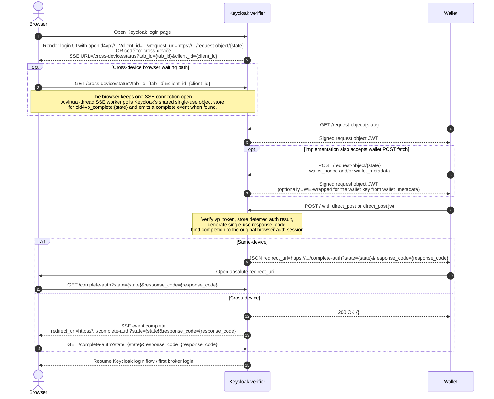
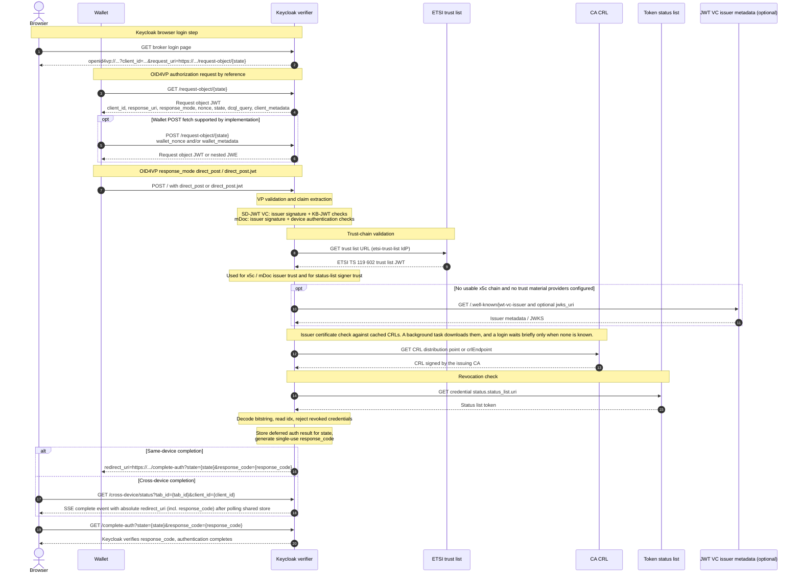

# Flow Details

## Key Concepts

### `response_code`

Single-use secret that authorizes `/complete-auth` ([OID4VP 1.0 §8.2](https://openid.net/specs/openid-4-verifiable-presentations-1_0.html)). It ties completion to one verified `direct_post`, so a holder of only the public `state` cannot drive `/complete-auth`. This closes a session-fixation attack.

- **Format:** 32 random bytes, Base64url-encoded (`SecretGenerator`), one per `direct_post` completion.
- **Exposure:** The request object never contains it. The browser learns it only from the server, through the wallet redirect or SSE.

Lifecycle:

1. `Oid4vpDirectPostService.storeAndSignal` generates it after verification and stores it in the `oid4vp_deferred:{state}` single-use object.
2. Keycloak embeds it in the `complete-auth` URL, the `redirect_uri` of the `direct_post` answer (same-device) or of the SSE `complete` event (cross-device).
3. The browser sends it to `/complete-auth`. Keycloak compares it in constant time before it consumes any single-use object.
4. Keycloak discards it when the flow is consumed.

### `state`

Public, stable identifier of one browser login flow, in the format `{flowTabId}.{UUID}` (Keycloak's auth session tab identifier and a fresh random value). `Oid4vpIdentityProvider.createFlowEntry` allocates it once per flow when Keycloak renders the login page.

- **Flow correlation:** Maps the flow to the stored request context `{rootSessionId, tabId, effectiveClientId, responseUri, flow}`. The entry and its completion and failure signals resolve only for the identity provider that created them, so a presentation posted to another OID4VP identity provider of the realm cannot complete this login.
- **Callback integrity:** The `state` the wallet echoes must match the stored context, so a callback cannot be rebound to a different flow.
- **Completion handle:** Names the deferred result `/complete-auth` consumes.
- **Path:** `request_uri` path (`/endpoint/request-object/{state}`), signed request object, the wallet's `direct_post`, then `/complete-auth?state=...&response_code=...`.

With the `state`, Keycloak allocates the `nonce` and, for `direct_post.jwt`, the ephemeral response-encryption key, all in one `RequestContextEntry` keyed by `oid4vp_state:{state}`.

- The key's `kid` is the `state`, so the cleartext JWE header of an encrypted callback identifies the context without a separate index.
- Repeated `request_uri` fetches return the same three values. Keycloak builds the signed request object on each fetch, because it can carry a `wallet_nonce` and can be encrypted to a key named in `wallet_metadata`.

### Liveness

The flow is live while its `state` entry exists. Keycloak removes the entry when:

- `Oid4vpDirectPostService.completeAuth` handles the first successful callback (`removeRequestContext`), which blocks replay.
- `/failed` hands the End-User back to the login page (`consumeFailure`) after a wallet error response, a rejected presentation, or an unexpected verification error. The attempt then serves no request object and accepts no presentation for the rest of the login timeout.

### Flow Integrity

The `state` is public: it travels in signed request objects and form parameters. These layers protect the flow:

- **Signature:** Keycloak signs the request object, which prevents tampering with `state`, `nonce`, `response_uri` and other claims.
- **Encryption:** With `direct_post.jwt` the wallet encrypts its response, which protects `vp_token` and `state` in transit.
- **Replay:** The `nonce` in the request object protects against it.
- **Transaction binding:** The KB-JWT (SD-JWT) or device authentication (mDoc) binds the presentation to the transaction.
- **`/complete-auth`:** Requires the `response_code`, and the browser auth-session cookie must match the attempt in the stored `{rootSessionId, tabId}`. `/failed` requires the `response_code` and the same browser-session check.
- **Tab endpoints:** `/cross-device/status`, `/expired` and `/refresh` look up `tab_id` only in the root authentication session named by the browser's own auth-session cookie. A copied URL finds nothing in another browser, and there `/expired` and `/refresh` hand over to Keycloak's restart, which fails without the original browser's `KC_RESTART` cookie.
- **Single completion:** The first verified `direct_post` for a `state` establishes the identity, and Keycloak ignores later submissions. This limits injection into a known `state`, the residual cross-device risk, because `state` travels in the public `request_uri`.
- **Per-state results:** One authentication session carries several live states, one per rendered flow. Each deferred result has auth notes named after its own `state` (`OID4VP_DEFERRED_IDENTITY:{state}`, `OID4VP_DEFERRED_CLAIMS:{state}`), so a presentation for another state of the session cannot become the identity `/complete-auth` reads back here.

## Login Page

```
Oid4vpIdentityProvider.performLogin(AuthenticationRequest)
```

1. `initializeLoginContext` computes `clientId` / `effectiveClientId`, chooses the auth-session tab ID for flow binding, and captures the browser routing parameters for the fallback form action.
2. `buildRedirectFlowData` allocates a `state`, nonce and encryption key per enabled flow, stores the context in `Oid4vpRequestObjectStore`, and builds the `request_uri` URLs.
3. `buildLoginFormResponse` passes wallet URLs, QR code and SSE status URL to `login-oid4vp-idp.ftl`.

The page contains:

- A same-device deep link (`openid4vp://...?client_id=...&request_uri=...`)
- A cross-device QR code encoding a similar URL (`openid4vp://...?client_id=...&request_uri=...`)
- A countdown to the first request URI to expire, capped at the end of the authentication session
- A cross-device SSE config div with `data-status-url` `/cross-device/status?tab_id=...&client_id=...`, read by `oid4vp-cross-device-sse.js`

### Request URI Lifetime

- **Fetch window:** Five minutes after page load by default (`sameDeviceRequestUriLifetimeSeconds`, `crossDeviceRequestUriLifetimeSeconds`). Later fetches get `404`.
- **Request object JWT:** Expires quickly (default 10 seconds).
- **Presentation window:** The request context stays until the authentication session expires, so a wallet that fetched in time can still present.
- **Countdown at zero:** The page navigates to `/expired?tab_id=...&client_id=...`, which renders `login-oid4vp-expired.ftl` with a **Get new link and QR code** button. The button opens `/refresh?tab_id=...&client_id=...`, which renders new states and a new QR code in the same authentication session. Both are `GET`, so reload and language switch work as usual.
- **Session ends first:** The countdown ends with it. `/expired` and `/refresh` redirect to Keycloak's `login-actions/restart`, which restarts from the `KC_RESTART` cookie and shows the login timeout message.
- **Live states:** The auth note `oid4vp.wallet-login-states.{alias}` records offered states. Those with a request context survive refreshes, up to `maxLiveRequestsPerLogin` (default `10`). Beyond that the oldest end, which stops refreshes from piling up stored requests. A completed login ends all of them.
- **Ended states:** Ending a state removes its request context, signals and deferred auth notes (see [Completion](#completion-complete-auth)), so a presentation for it cannot complete the login.
- **Older QR codes:** `/cross-device/status` watches all live cross-device states of the tab, and the expired page keeps that connection open, so a wallet finishing an older QR code moves the browser on.

## Request Object Fetch

The wallet URL advertises only `client_id` and `request_uri`. Wallets normally use `GET`. `POST` lets a wallet send `wallet_nonce` and/or `wallet_metadata`.

```
Oid4vpIdentityProviderEndpoint.getRequestObject(state)
    or
Oid4vpIdentityProviderEndpoint.postRequestObject(state, walletNonce, walletMetadata)
    both call →
Oid4vpRequestObjectService.generateRequestObject(state, walletNonce, walletMetadata)
```

1. Loads the request context `{rootSessionId, tabId, effectiveClientId, responseUri, flow, state, nonce, encryptionKey}` from `Oid4vpRequestObjectStore`.
2. Rejects the fetch after the stored `requestUriExpiresAtEpochSeconds`. This deadline applies only to request-object retrieval.
3. Resolves the auth session from `rootSessionId` + `tabId`, which confirms the attempt is active.
4. Calls `Oid4vpRedirectFlowService.buildSignedRequestObject(params)` with the stored `state`, `nonce` and key.
5. POST only: parses `wallet_metadata` after signing. When it names a request-object encryption key, `Oid4vpRequestObjectEncryptor.encrypt` wraps the signed JWT in a JWE with `cty` `JWT` (Nested JWT). The HTTP content type remains `application/oauth-authz-req+jwt`.

```
Oid4vpRedirectFlowService.buildSignedRequestObject(RequestObjectParams)
```

1. **Keys:** The configured x509 signing JWK, otherwise the realm signing key. For `direct_post.jwt`, the per-flow ECDH-ES response-encryption key.
2. **Claims:** `jti`, `iat`, `exp`, `iss`, `aud`, `client_id`, `response_type` (always `vp_token`), `response_mode`, `response_uri`, `nonce`, `state`, optional `wallet_nonce`, DCQL query, verifier info, `client_metadata`.
3. **`client_metadata`:** Always carries `vp_formats_supported`. For encrypted wallet responses it also carries the public response-encryption JWK in `jwks` and the supported encryption methods.
4. **`trusted_authorities` per DCQL credential:** Each entry advertises what the trust material identity providers serving its type expose: a trust list URL as `etsi_tl`, certificate key identifiers as `aki`. The member is absent when the trust domain has nothing to advertise or the provider leaves `advertiseTrustedAuthorities` empty. Per OID4VP 1.0 §6.1.1 the entries are alternatives, and a credential matches when it matches one value of one entry.
5. **JWS:** `Oid4vpRequestObjectSigner` attaches `x5c` or public `jwk` headers as the client-id scheme requires and signs through Keycloak key abstractions.

The result is `SignedRequestObject(jwt)`. The encryption key it advertises is the `EphemeralKey` of the request context entry.

## VP Token Submission

Both flows POST to the `response_uri`.

| Response mode | Form body |
|---------------|-----------|
| `direct_post` | `vp_token` and `state` |
| `direct_post.jwt` | `response=<JWE/JWT>`, whose decrypted payload must contain `state`, optionally a separate `state` |

```
Oid4vpIdentityProviderEndpoint.handlePost(state, vpToken, encryptedResponse, error, errorDescription)
```

1. Reads `state`, `vp_token`, `response`, `error` and `error_description`.
2. Resolves the request context from `Oid4vpRequestObjectStore` by the posted `state`, or by the JWE header KID when an encrypted response omits it.
3. Resolves the auth session from `{rootSessionId, tabId}`.
4. For `direct_post.jwt`, decrypts `response` with the context's private key and extracts `vp_token`, `state`, `error` and `error_description`. The decrypted `state` must match the context and any separately posted `state`.
5. For a wallet OAuth error (for example `access_denied`), records it server-side and answers HTTP 200. A same-device answer carries the `redirect_uri` back to `/failed`.
6. Takes same-device or cross-device behavior from the stored `flow` and ignores any `flow` query parameter.
7. Calls:

   ```
   processVpToken(authSession, requestContext, state, vpToken, isCrossDeviceFlow)
   ```

8. Verifies the credential (see [Credential Verification](#credential-verification)):

   ```
   Oid4vpCallbackProcessor.process(requestContext, vpToken)
   ```

9. Stores deferred auth and returns the redirect:

   ```
   directPostService.storeAndSignal(authSession, state, flow, endpointBaseUrl, context, isCrossDeviceFlow)
   ```

### Credential Verification

`Oid4vpCallbackProcessor.process`:

1. Validates that a request context was resolved.
2. Calls `VpTokenProcessor.process` with the `vp_token`, the context's `clientId`, `nonce` and `responseUri`, the RFC 7638 thumbprint of its `encryptionKey`, and the request-scoped credential types captured when the request object was created.
3. Validates that the issuer and the credential type are allowed.
4. Rejects credentials whose `vct` / `docType` this IdP's DCQL query did not request and which derive from no requested type.
5. Maps claims to `BrokeredIdentityContext`.

**SD-JWT:** `SdJwtVerifier.verify()` requires the `typ` `dc+sd-jwt`, or `vc+sd-jwt`, which [SD-JWT VC draft 13, section 3.2.1](https://www.ietf.org/archive/id/draft-ietf-oauth-sd-jwt-vc-13.html#section-3.2.1) recommends accepting for a transitional period. It then delegates to Keycloak's `SdJwtVP.verify()`:

1. **Issuer signature**, with the key resolved in this order:
   - `x5c` chain validation against the resolved trust material. The chain passes with a pinned trusted leaf that satisfies any configured issuer binding, or a PKIX path to the trust anchors that authenticates the leaf's subject (`ResolvedTrust.validateIssuerChain`). With `requireIssuerSanMatch`, `Oid4vpTrustedSdJwtIssuer` also checks the issuer against the validated leaf's SANs.
   - The issuer keys the credential's trust domain publishes, matched on `iss` and JOSE `kid`.
   - Only with no trust material providers configured: JWT VC issuer metadata via `iss` + `kid` (`JwtVcIssuerMetadataResolver`), including `jwks_uri`.
2. **Issuer JWT times:** `exp` and `nbf`, with configurable clock skew (default 60s). There is no `iat` freshness check, so an old credential stays valid as long as `exp` holds.
3. **Disclosures:** SHA-256 hashes of disclosed claims match the `_sd` digests.
4. **KB-JWT signature:** Against the holder key in the credential's `cnf.jwk`.
5. **KB-JWT claims:** `aud` matches `clientId` ([OID4VP 1.0 Appendix B.3.6](https://openid.net/specs/openid-4-verifiable-presentations-1_0.html#appendix-B.3.6)), `nonce` matches the request object, `iat` is fresh (default max age 300s + 60s clock skew), and `exp` and `nbf` hold if present.
6. **KB-JWT `sd_hash`:** Equals SHA-256 of the unbound presentation (issuer JWT + disclosures, without the KB-JWT).

**mDoc:** `MdocVerifier.verifyPresentation()`:

1. **Issuer signature:** The MSO COSE_Sign1 signature.
2. **Value digests:** IssuerSignedItems, with the digest algorithm the MSO declares.
3. **Validity:** `validFrom`/`validUntil` within the configured clock skew. An MSO without `validityInfo` is rejected.
4. **Device authentication:** The signature over the SessionTranscript of [OID4VP 1.0 Appendix B.2.6.1](https://openid.net/specs/openid-4-verifiable-presentations-1_0.html#appendix-B.2.6.1), `[null, null, ["OpenID4VPHandover", SHA-256(CBOR([client_id, nonce, jwk_thumbprint, response_uri]))]]`. The `jwk_thumbprint` is the RFC 7638 SHA-256 thumbprint of the response encryption key from `client_metadata.jwks`, computed from the stored `EphemeralKey`, and null for an unencrypted response.
5. **Claims:** Extracts namespace-prefixed claims.

**Both formats:**

- **CRLs:** `CrlVerifier` checks the chain's issuer certificates and skips anchors, pinned certificates, and certificates without a CRL distribution point. It follows only certificates that lead to a trust anchor. `crlRequired` rejects a certificate with unreadable or only non-http(s) points, or without a path to an anchor. A configured `crlEndpoint` replaces the leaf's distribution points. A background task downloads CRLs. A login uses what is cached and waits up to 3 seconds only when no CRL is known. Without one, `crlRequired` rejects the credential, and otherwise the check is skipped.
- **Status lists:** `StatusListVerifier` checks revocation. The status list URI has to be an https URL.
- **Trust lists:** The referenced ETSI trust list identity providers validate their `LoTEType` against their trust domain while resolving trust material.

### Accepted Deviations from the Specification

The verifier accepts two shapes OID4VP 1.0 does not require, for wallet interoperability.

- **VP token shape:** The `vp_token` maps each DCQL credential id to an array of exactly one presentation, because the generated queries carry no `multiple` (OID4VP 1.0 §8.1). `VpTokenProcessor` also accepts a bare presentation string when the query requests exactly one credential. When one id carries several presentations, it verifies each and uses the first, and an invalid one fails the login.
- **mDoc DeviceResponse:** Each mDoc arrives in its own `DeviceResponse`, one per credential query (high assurance profile 1.0, section 5.3.1). `MdocVerifier` reads the first document and ignores further documents and the `status` and `documentErrors` members.

### Deferred Result

`Oid4vpDirectPostService.storeAndSignal`, for both flows:

1. **Single-completion guard:** If `oid4vp_deferred:{state}` exists unconsumed, it returns that completion idempotently and stores nothing. A later presentation, for example an attacker's own credential, cannot replace the first identity, and a wallet can safely retry its own `direct_post`. A repeated verified presentation fires `CompletionRejectedEvent` with `REPEATED_PRESENTATION` and no `PresentationVerifiedEvent`. Only verified presentations reach this method, so a failed one never locks the flow.
2. Serializes the `BrokeredIdentityContext` into the auth session (`DEFERRED_IDENTITY_NOTE`).
3. Stores claims JSON separately (`DEFERRED_CLAIMS_NOTE`), because Keycloak's serializer loses nested Map types.
4. Generates the `response_code` and stores the single-use objects:

| Object | Content | TTL | Reader |
|--------|---------|-----|--------|
| `oid4vp_deferred:{state}` | `{rootSessionId, tabId, response_code}` | Realm login timeout | `/complete-auth` |
| `oid4vp_complete:{state}` (cross-device only) | `{completeAuthUrl}`, with the `response_code` | `crossDeviceCompleteTtlSeconds` | SSE polling, until `/complete-auth` removes it |

Keycloak builds the `completeAuthUrl` and failure URL from the endpoint base the browser reached at render (`responseUri` in the request context), so the wallet's request host cannot end up in a URL the browser follows. The browser script follows an SSE redirect only to the page's own origin.

| Flow | Wallet response | Next step |
|------|-----------------|-----------|
| Same-device | `{"redirect_uri": "/complete-auth?state=...&response_code=..."}` | The wallet opens this URL in the browser. |
| Cross-device | `200 OK` with `{}` body | The browser's SSE connection receives the signal and navigates to `/complete-auth?state=...&response_code=...`. |

### Completion: `/complete-auth`

```
Oid4vpIdentityProviderEndpoint.completeAuth(state, responseCode)
    → Oid4vpDirectPostService.completeAuth(state, responseCode, callback, event)
```

1. Reads `oid4vp_deferred:{state}` without consuming it and **verifies the `response_code` in constant time before consuming anything**, so a known `state` plus a wrong code cannot burn the legitimate signal.
2. Resolves the stored auth session from `rootSessionId` + `tabId`.
3. Requires the browser's auth-session cookie to match that session.
4. Consumes `oid4vp_deferred:{state}` and the cross-device completion marker.
5. Restores the `BrokeredIdentityContext` from `DEFERRED_IDENTITY_NOTE` and the claims from `DEFERRED_CLAIMS_NOTE`.
6. Ends every state the page offered in this authentication session, the completed one included: request contexts, signals, deferred auth notes and the `oid4vp.wallet-login-states.{alias}` note. The other states can neither serve a request object nor complete or fail the login, and their entries leave the single-use store before the login timeout.
7. Calls `callback.authenticated(context)`, and Keycloak completes the login.

### Cross-Device SSE

```
Oid4vpIdentityProviderEndpoint.crossDeviceStatus(tabId, eventSink, sse)
    → Oid4vpCrossDeviceSseService.subscribe(states, eventSink, sse, authSession)
```

1. The endpoint finds the tab's authentication session through the browser's own auth-session cookie and collects its live cross-device states. With none, it answers HTTP 204, which stops reconnects.
2. The service polls `singleUseObjects` for `oid4vp_complete:{state}` and `oid4vp_failed:{state}` of each state.
3. On completion it sends `event: complete` with `{"redirect_uri": "/complete-auth?state=...&response_code=..."}`. The marker stays, so a reconnecting client sees the same event until `/complete-auth` consumes it.
4. On failure it sends `event: failed` with the failure URL as `redirect_uri`.
5. The browser JavaScript navigates to the `redirect_uri`.

Each connection runs on its own virtual thread, which polls Keycloak's shared single-use store until the flow completes, expires, or times out. Keycloak needs no cluster notification channel. The store must be shared across nodes, and reconnects can then resume on any node.

## Error Handling

Failures travel the back channel and move no browser by themselves. A same-device wallet gets the `redirect_uri` it must follow, as for a completed login. A cross-device wallet gets the empty object, and Keycloak publishes the failure URL on the SSE stream.

The reason is a verification message neither a wallet nor an End-User can act on. It stays on the `LOGIN_ERROR` event and in the server-side failure record.

`/failed` requires the `response_code` and the browser auth-session cookie to match the attempt before it consumes anything, reads the failure from the record (never from query parameters), drops the request context, and returns the End-User to the login page.

| Outcome | Examples | Response URI answer | Login ends with |
|---------|----------|---------------------|-----------------|
| Wallet-reported error | Consent denied, credential not available | HTTP 200, because the Response URI processed the Authorization Error Response | `callback.cancelled()`, the standard "access denied" message, and retry or another method |
| Rejected presentation | Revoked credential, invalid signature, unsatisfied DCQL | `rejectionResponse`, default HTTP 200 | `callback.error()` naming `oid4vpPresentationRejected`. The End-User learns of the rejection, and the verification message stays on the login event. |
| Broken verification | Unexpected exception while verifying, status list or required CRL unavailable, no issuer trust because a trust list had no usable copy | HTTP 200 and `server_error` on the login event. `rejectionResponse` does not apply, because nothing about the credential was judged. | `callback.error()` naming `oid4vpVerificationFailed` |
| Post that never reaches verification | Unknown state, undecryptable response, unencrypted response where encryption is required | Plain HTTP 400, no `redirect_uri` | Nothing. No proof links the post to the wallet whose login it names, so it must not end that login. |
| Exception outside verification | | HTTP 500 and `server_error` | |

`rejectionResponse`:

- **Default:** HTTP 200, because the Response URI processed the response and refused what it found. A wallet that stops on a non-2xx status does not follow the `redirect_uri`.
- **`error`:** HTTP 400 with the `error` and a generic `error_description`, because the verification message can describe the trust configuration. Same-device keeps the `redirect_uri` beside them, cross-device gets the error alone. §8.2 permits both.
- A wallet-reported error gets 200 either way.

The response URI has no `GET` handler. A wallet that redirects an error there proves neither that it is the End-User's browser nor that the error happened, so such a request cannot end a login.

## Class Responsibilities

| Class | Role |
|-------|------|
| `Oid4vpIdentityProvider` | Login page rendering, session state init, per-flow context and key allocation, DCQL query building |
| `Oid4vpIdentityProviderEndpoint` | Thin JAX-RS adapter for request-object, direct_post, SSE, and complete-auth routes |
| `Oid4vpRequestObjectService` | Request-object creation, wallet-metadata encryption |
| `Oid4vpEndpointResponseFactory` | JSON error payloads and wallet redirect responses |
| `Oid4vpRedirectFlowService` | Request claims, client_metadata, wallet authorization URLs |
| `Oid4vpRequestObjectSigner` | Compact JWS creation for request objects |
| `Oid4vpRequestObjectEncryptor` | Request-object JWE encryption based on wallet_metadata |
| `Oid4vpCallbackProcessor` | VP token verification orchestration, claim mapping |
| `VpTokenProcessor` | Credential format detection, SD-JWT/mDoc verification, revocation checks |
| `SdJwtVerifier` | SD-JWT and KB-JWT verification, disclosure resolution, verification-order policy |
| `JwtVcIssuerMetadataResolver` | Issuer metadata discovery (`/.well-known/jwt-vc-issuer`), `jwks`/`jwks_uri` lookup, bounded caching by response TTL and JWK `exp` |
| `MdocVerifier` | mDoc issuer/device auth, digest/validity checks, claim extraction |
| `OpenId4VpHandoverInfo` | OID4VP 1.0 SessionTranscript for the mDoc device signature |
| `StatusListVerifier` | Token Status List fetching, caching, revocation bit checking |
| `CrlVerifier` | Background CRL download and refresh, caching, certificate checks against cached CRLs |
| `EtsiTrustListIdentityProvider` | Trust material identity provider (`etsi-trust-list`): trust anchors from an ETSI trust list URL and/or a pasted PEM bundle, LoTE type enforcement |
| `Oid4vpTrustMaterialResolver` | Aggregates trust material identity providers by alias into `ResolvedTrust`. PKIX validation uses Keycloak's `X509CertificateChainValidator`. Anchors may be intermediate CAs (`IssuerTrustAnchors`), unlike Keycloak's `X509TrustMaterial`, which accepts self-signed roots only |
| `TrustListProvider` | ETSI trust list fetching, certificate extraction, caching, optional JWT signature verification |
| `X5cChainValidator` | JWT signature verification against pinned certificates (status list, trust list) |
| `Oid4vpDirectPostService` | Deferred auth storage, session restoration at `/complete-auth` |
| `Oid4vpCrossDeviceSseService` | Node-local SSE subscriptions for cross-device completion |
| `Oid4vpRequestObjectStore` | Transient per-flow request context storage keyed by `oid4vp_state:{state}` |
| `Oid4vpAuthSessionResolver` | Auth session lookup from request object store (state→session, rootSessionId→tabId) |
| `Oid4vpResponseDecryptor` | direct_post.jwt decryption through Keycloak's `ResponseEncryption`, which accepts `ECDH-ES` with `A128GCM` or `A256GCM` only |
| `DcqlQueryBuilder` | DCQL queries from IdP mapper configurations |

## Configuration Notes

- **Trust location:** Trust material identity providers (`etsi-trust-list`, `keycloak-realm-issuer`), referenced via `trustMaterialIdps`. This mirrors upstream Keycloak's OID4VP trust material delegation model.
- **Per-credential trust:** A provider serves the types in `servedCredentialTypes`, or every type while empty. Keycloak verifies a credential against the providers serving the type requested under its DCQL credential id, and that entry advertises their `trusted_authorities`.
- **`trustListLoTEType`:** When set, the fetched list must match it, which binds one provider to one trust domain. When empty, all LoTE types are accepted.
- **Service types:** Issuer verification uses certificates from `.../SvcType/.../Issuance` services only, status-list verification from `.../SvcType/.../Revocation` services only.
- **Credential types:** The verifier trusts only the types requested for that IdP and types derived from them.
- **`trustListSigningCertPem`:** Without it, Keycloak does not verify the trust-list JWT signature and trusts the list as fetched. The code warns and does not fail startup.
- **Certificate-bound `clientIdScheme`:** Keycloak uses the configured verifier certificate PEM for client ID derivation and the request object `x5c` header. Every certificate has to be valid and signed by the next. The wallet judges acceptability against its own relying party trust list. Keycloak warns about a self-signed or lone leaf certificate and does not reject it. Issuer trust comes from the trust material identity providers.

## Diagrams

### High-Level Interaction



### Protocol Mapping


